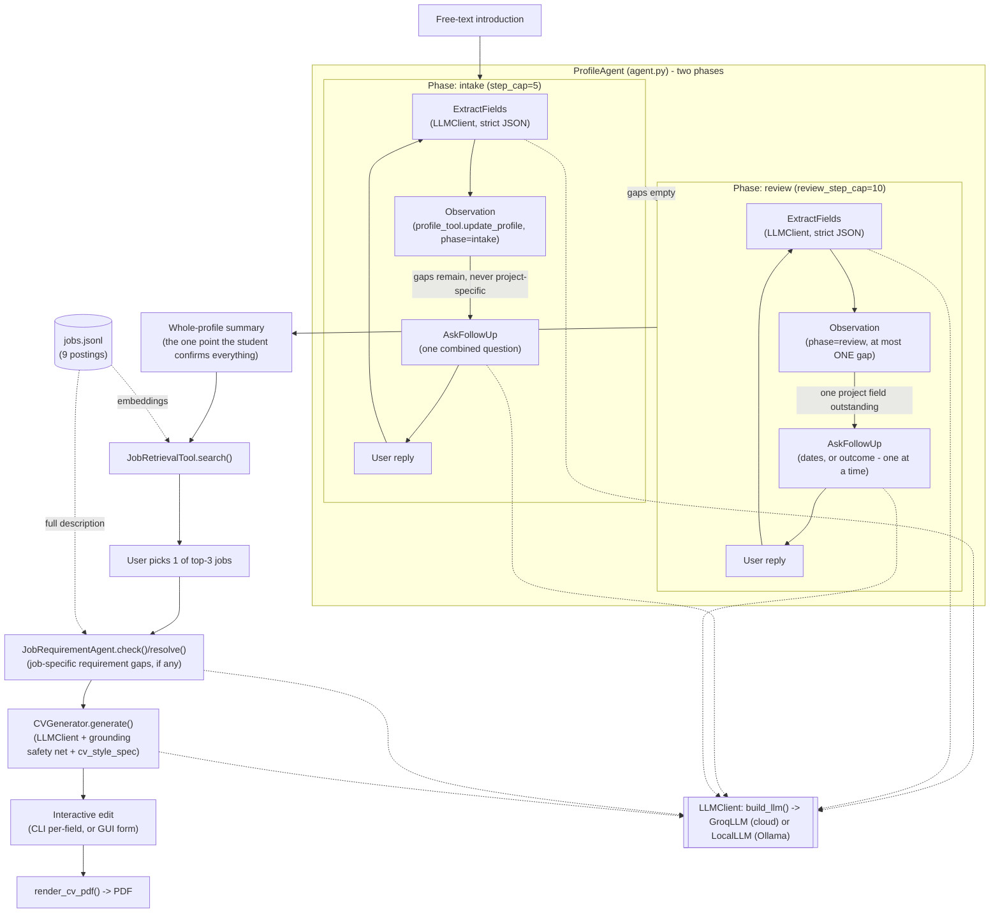

# Architecture

> **Note (Assignment 3):** the source code described here now lives in
> `backend/app/cv_builder/` at the repo root, where RehearseAI's FastAPI backend wraps it
> (`backend/app/services/cv_builds.py`, `backend/app/routers/cv_builds.py`) and its React
> frontend replaces `cv_builder_gui.py`, which has been removed. The modules, prompts and
> grounding safety net are unchanged apart from package imports and paths. This document
> is kept as the Assignment 1 record.

AI-powered CV Builder: a conversational agent turns a free-text introduction into a
structured profile (in two phases — see below), retrieves relevant jobs, checks the
confirmed profile against the specific job's own stated requirements, generates a
tailored, style-consistent CV grounded strictly in that profile, and exports it to PDF.
Everything runs locally except the LLM calls (GROQ's cloud API by default, or a model
running locally via Ollama — see `LLM_BACKEND` below) and a one-time Hugging Face
download of the embedding model used for job retrieval.

See `architecture_diagram.png` for the component/data-flow diagram this document
describes.

## Components

| File | Role |
|---|---|
| `source_code/data/*.jsonl` | The dataset: 9 job postings, 5 synthetic confirmed profiles, 5 synthetic introductions |
| `profile_model.py` | Two data models: `Profile` (the full confirmed schema — contact, education, skills, experience, projects, achievements, job goal) and `DraftProfile` (the smaller subset an agent can actually fill in from free text, with `merge()`, `compute_gaps(phase)`, and `to_profile()` bridging back to `Profile`) |
| `profile_tool.py` | `ProfileTool` — the agent's one tool for reading/writing profile state; every call returns an Observation (`draft`, `gaps`) |
| `agent.py` | `LLMClient` (the common interface), `GroqLLM` (cloud) and `LocalLLM` (a model running locally via Ollama) behind it, `build_llm()` (picks one via `LLM_BACKEND`), `ProfileAgent` (the two-phase intake/review loop), and `JobRequirementAgent` (per-job requirement gap-check) |
| `job_retrieval_tool.py` | `JobRetrievalTool` — sentence-transformers embeddings + cosine similarity over `jobs.jsonl`, with sentence-level excerpt selection |
| `cv_generator.py` | `CVGenerator` — LLM-backed CV generation grounded strictly in a confirmed `Profile` and styled per `cv_style_spec.py`, with a deterministic post-generation safety net that strips anything not traceable to the profile and any bullet announcing a fact's absence |
| `cv_style_spec.py` | The CV's literal formatting spec (fonts with a Times New Roman → Times-Roman fallback, name/section/body sizes, one accent colour, section order, date-range formatting, skill categories) — applied to every export, never derived from a user-uploaded file |
| `cv_pdf.py` | `render_cv_pdf` — reportlab-based PDF rendering per `cv_style_spec.py` (two-column entry headers, per-line bullets) |
| `export_cv.py` | CLI: CV + PDF export starting from an already-confirmed dataset profile |
| `cv_builder_cli.py` | CLI: the complete flow, intro text through to PDF (`run_full_flow`) |
| `cv_builder_gui.py` | Streamlit GUI: the same complete flow in a browser, with multiple concurrent sessions (sidebar), an in-page project-review chat, and inline PDF preview |
| `tests/run_*.py` | Per-feature and full-system test scripts, each writing its results into `03_Evidence/` |

## Data flow

Step limits: intake and review each have their OWN cap and counter (`ProfileAgent.step_cap`,
default 5; `review_step_cap`, default 10) — `ExtractFields`/`AskFollowUp`/the final summary
each count as one step in whichever phase is active. Projects are never asked about during
intake at all (dates, outcome, and — never, in either phase — measurable results/metrics);
they are deferred entirely to the review phase, which asks about at most one project field
of one entry per turn, never batched with anything else. Neither phase ever re-confirms a
single already-stated fact in isolation ("does that look right?") — a stated fact is trusted
the moment it's captured; the only point everything is confirmed together is the one
whole-profile summary shown once both phases are done.

## Why these choices

- **An `LLMClient` interface over a single hardcoded provider**: `GroqLLM` (GROQ's cloud
  API) and `LocalLLM` (a model run locally via Ollama) both implement the same two
  operations (`extract_json`/`generate_text`); `build_llm()` picks one via the
  `LLM_BACKEND` env var, so every other class (`ProfileAgent`, `JobRequirementAgent`,
  `CVGenerator`) never knows or cares which is actually running. Model: `openai/gpt-oss-20b`
  in both cases (GROQ hosts it; `LocalLLM` can run the same open-weight model locally via
  Ollama) — a reasoning model, so calls need a generous `max_tokens` budget (hidden
  reasoning tokens are spent before the visible JSON/text output; this caused a real
  failure on both backends, see `failure_and_repair.md`). `LocalLLM` additionally needs an
  explicitly widened Ollama context window (`num_ctx`, default 16384) — Ollama's own
  runtime default (4096) is too small for this project's own system prompts and silently
  produces empty completions regardless of `max_tokens`.
- **sentence-transformers (`all-MiniLM-L6-v2`) for job retrieval**: real dense embeddings,
  runs fully locally after a one-time model download, no per-call API cost or dependency on
  the LLM backend having an embeddings model (GROQ doesn't have one; local models generally
  don't either).
- **`DraftProfile` as a distinct type from `Profile`**: a free-text introduction can supply
  name, degree, institution, year, skills, projects/experience, and target roles, but
  nothing beyond what the student actually states — institution, education dates, and
  project details are all genuinely asked for and confirmed, never defaulted or assumed.
  (An earlier version of this project hardcoded institution/faculty/campus/program_mode to
  fixed values for every profile; this was identified as exactly the kind of unconfirmed
  claim the grounding rules below exist to prevent, and removed.) `DraftProfile.to_profile()`
  bridges the confirmed draft into a real `Profile`, so the rest of the system (retrieval,
  CV generation) only ever deals with one profile type.
- **Deterministic grounding safety net in `CVGenerator`**: the system prompt instructs
  "no invented facts" and "never announce an absence," but a prompt is not a guarantee.
  After parsing the LLM's JSON response, every skill/project/experience claim is checked
  against the confirmed profile's actual fields (anything unmatched is stripped and logged
  as a `grounding_warning`), and every bullet is checked against a narrow set of
  absence-announcing patterns ("no metrics were tracked," etc.) so an optional fact that
  wasn't provided is simply omitted, never mentioned as missing.
- **`cv_style_spec.py` as literal, hardcoded formatting rules**: font, colour, section
  order, and date-range formatting are constants applied to every export automatically,
  never derived from a user-uploaded file (if upload is ever added, it would only ever be a
  source of facts to extract, never of styling).
- **reportlab over WeasyPrint/HTML-to-PDF**: pure Python, no system-level dependencies
  (WeasyPrint needs GTK/Pango/Cairo, which is painful on Windows). Its `platypus` layout
  engine gives real typographic control (distinct paragraph styles, automatic wrapping,
  two-column entry headers) without needing a browser or external binary.
- **Both a CLI and a GUI, sharing the same core classes**: every feature was built and
  tested incrementally through runnable CLI scripts; `cv_builder_cli.py` composes the same
  tested pieces (`ProfileAgent`, `JobRetrievalTool`, `JobRequirementAgent`, `CVGenerator`,
  `render_cv_pdf`) into one interactive entry point, with `--intro-file`/`--replies-json`/
  `--review-replies-json`/`--job`/`--edits-json`/`--output`/`--llm-backend` flags so the
  same script is also scriptable for automated testing. `cv_builder_gui.py` wraps the exact
  same classes in a Streamlit browser UI with multi-session support (a sidebar of
  independent conversations) — neither reimplements the other's logic.

## Isolation

Each `ProfileAgent` owns its own `ProfileTool` (and therefore its own `DraftProfile`)
created fresh in `__init__` — there is no shared/global/class-level mutable state between
agents. `JobRetrievalTool` and any `LLMClient` (`GroqLLM` or `LocalLLM`) are stateless with
respect to any one user (they hold a model/client, not per-user data) and can be safely
shared across concurrent agents — including across the GUI's multiple sidebar sessions,
each of which owns its own `ProfileAgent`/`ProfileTool` instance. This is verified directly
in `03_Evidence/04_System_Tests/cross_user_test.md`: two users run in the same process, and
neither's profile, job matches, or generated CV shows any trace of the other's data.
