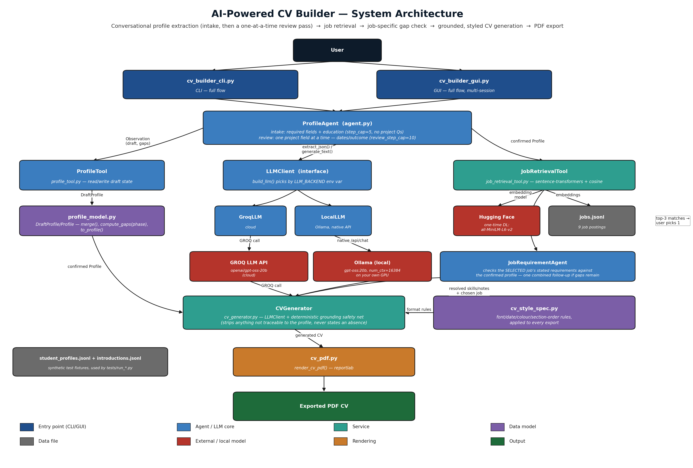

## Assessment 1: AI-Powered CV Builder

**Student name:** Norapat Kittivises
**Student ID:** 25384759
**Word count:** 1,566
### 1. Task and System

The AI-Powered CV Builder converts a student's free-text self-introduction into a tailored, fact-checked CV exported as a PDF. Inputs comprise an initial introduction, follow-up replies collected across two phases, a chosen target job, and optional field edits made before export. Outputs comprise a confirmed structured `Profile`, a ranked list of matching jobs, a job-specific requirement gap-check, a generated CV, and a rendered PDF.



*Figure 1: System architecture, from profile intake through job retrieval to CV export.*

As the diagram shows, the user starts at `cv_builder_cli.py` or `cv_builder_gui.py`, both of which drive the same `ProfileAgent` (`agent.py`). `ProfileAgent` runs an intake phase (step cap 5) that extracts required fields and education via `ProfileTool`/`profile_model.py`'s `DraftProfile`, then a review phase (step cap 10) that asks about one project field at a time. Every extraction call goes through the shared `LLMClient` interface, implemented by `GroqLLM` or `LocalLLM` depending on `LLM_BACKEND`. Once confirmed, `JobRetrievalTool` embeds the profile with `sentence-transformers` and returns the top three jobs from `data/jobs.jsonl`. After the student picks one, `JobRequirementAgent` checks that job's own stated requirements against the profile. `CVGenerator` then produces a tailored CV grounded strictly in the confirmed profile, with a deterministic safety net stripping anything unsupported. The student edits fields before `cv_pdf.py`'s `render_cv_pdf()` exports the final, styled PDF.

### 2. Prompt, Agent and RAG

##### 2.1 Prompt Design

The clearest documented improvement is the revision from `CV_GENERATION_SYSTEM_PROMPT_V1` to `_V2` in `cv_generator.py`. The objective was to correct an observed flaw: the generated "skills" array returned in the same order regardless of target job, despite the prompt already instructing entries to be ordered "to foreground relevance." The fix strengthened TASK point 1 and the `"skills"` line in OUTPUT FORMAT to require ordering skills most-relevant-to-`selected_job` first, so ordering now differs by job.

| | Before (V1) | After (V2) |
|---|---|---|
| Skills order, two jobs | Identical both jobs:<br>`Python, pandas, NumPy,`<br>`scikit-learn, PyTorch basics,`<br>`SQL, Hugging Face Transformers`<br>`basics, Git, Jupyter Notebook` | Differs per job:<br>- data-science stack leads for `graduate_ai_engineer`<br>- LLM stack (Transformers, PyTorch) leads for `rag_agent_engineer` |
| Grounding warnings | none | none |

*Table 1: Skills ordering before (V1) and after (V2) the prompt fix.*

`run_prompt_comparison_test.py` ran one profile (Liam Patel) against the same two jobs under both versions. In that comparison, V2 changed the ordering without loosening grounding, so it became the default. The later Ethan two-job run below did not reproduce a skills-order difference, which is reported as a remaining limitation rather than presented as a universal guarantee. The same propose-test-confirm pattern shaped every later revision up to `_V13` (CV-register rewriting, fixed section order, no placeholder text or absence-announcing bullets).

##### 2.2 Tool-Calling Agent

`ProfileAgent`'s only tool is `ProfileTool`, called with an extracted-fields dict and a `phase` argument ("intake" or "review"); every call returns an Observation containing `draft`, `missing_fields`, `gaps`, and `new_facts`. Figure 2 traces one such turn from `follow_up_question_test.md`, in which the student's first message left name, education dates, and target roles missing.

```
Step 1 - Action: ExtractFields
  Observation: gaps=[name, education_dates, target_roles]
Step 2 - Action: AskFollowUp
  Observation: question="...Could you let me know your full name, the start
  and end dates for your primary degree, and which roles you're targeting?"
```
*Figure 2: Short Action and Observation trace (`follow_up_question_test.md`).*

Internally, **Action** `ExtractFields` calls `self.llm.extract_json(EXTRACTION_SYSTEM_PROMPT,...)`, then `self.tool.update_profile(extracted, phase="intake")` runs `DraftProfile.merge()`/`compute_gaps()`, producing the `gaps=[name, education_dates, target_roles]` Observation in Step 1. Non-empty gaps trigger **Action** `AskFollowUp` (Step 2), combining all three via `FOLLOW_UP_SYSTEM_PROMPT`. The student's reply ("Oh sorry, I'm Priya Kapoor.") triggers another `ExtractFields` cycle, updating the draft's name and narrowing `gaps`; this repeats until `gaps=[]`, yielding `FinalAnswer` (plus `RetrieveJobs` if a `job_tool` is attached). The stopping condition is therefore either an empty-gaps `FinalAnswer`, or the phase's step cap (5 intake/10 review) returning `step_limit_reached`. `JobRequirementAgent` is stricter: `check()` asks one combined question per job, `resolve()` finalises every gap that turn — unconfirmed items are recorded via `decline_requirements()` and never re-asked.

##### 2.3 Retrieval-Augmented Generation

`JobRetrievalTool` loads all nine postings from `data/jobs.jsonl` at start-up and encodes each title+description with local `sentence-transformers` model `all-MiniLM-L6-v2`; each description is also sentence-split and embedded separately so one specific sentence, not a generic label, becomes the matching excerpt. A profile's query text (target roles, summary, skills, project/experience descriptions) is embedded and ranked against every job embedding by cosine similarity (`_cosine_sim`); the top three by score are returned.

Table 2 shows the top three matches returned for Maya Chen (`student_profile_01`), with the exact `document_id` and the specific sentence-level excerpt that justified each match.

| document_id | score | supporting excerpt |
|---|---|---|
| `agentic_ai_engineer` | 0.66 | "Deliver end-to-end AI solutions; develop agentic workflows...using Python, Langflow, and modern AI tooling" |
| `rag_agent_engineer` | 0.6467 | "Develop LLM-powered AI applications; design and optimise RAG pipelines and AI-agent workflows" |
| `graduate_ai_engineer` | 0.627 | "Develop and evaluate machine-learning models and AI agents" |

*Table 2: Retrieved jobs and supporting evidence — Maya Chen (`student_profile_01`).*

### 3. Evaluation

##### 3.1 Five-Profile Test

| Profile | Expected | Follow-ups | Top job | Grounding warnings |
|---|---|---|---|---|
| Ethan Brooks — backend (complete) | 0–1 | 1 | `rag_agent_engineer` | none |
| Priya Nair — data/analytics (complete) | 0–1 | 2 | `graduate_ai_engineer` | none |
| Devon Okafor — AI/NLP (incomplete) | several | 4 | `nlp_multimodal_ml_engineer` | none |
| Marcus Webb — cybersecurity (incomplete) | several | 3 | `trust_safety_ml_engineer` | none |
| Sarah Chen — full-stack/cloud (incomplete) | several | 3 | `agentic_ai_engineer` | none |

All five reached `status: confirmed` with zero grounding warnings. Marcus Webb's introduction named no concrete tool ("set up a small home lab and documented common attack patterns... while monitoring traffic"); gap-detection correctly flagged `technical_skills` as missing rather than inventing or accepting a vague label, and his follow-up reply ("Linux, Wireshark, and basic network troubleshooting") supplied concrete tools before confirmation — `profile_4_marcus_webb.md`'s confirmed profile lists only `["Linux", "Wireshark"]`.

##### 3.2 Two Jobs for the Same User

Ethan Brooks's profile generated CVs for two jobs from his own top three; the profile dict was confirmed unchanged both before and after both calls. Both rendered PDFs are provided in Appendix F.

| | Job A: `rag_agent_engineer` | Job B: `healthcare_ml_engineer` |
|---|---|---|
| Summary | Toward "AI-powered enterprise applications" | Toward "machine-learning engineering" |
| Skills order | Python, SQL, Git, Spring Boot, PostgreSQL, Java | Identical to Job A |
| Matched skills | Python | Python, SQL, Git, Spring Boot, PostgreSQL |
| Projects | Same project/dates/technologies, reworded per job | Same |
| Missing requirements | 9 items | 11 items |

Summaries, matched skills, and missing requirements tailor genuinely per job with zero grounding warnings. Two limitations remain: the flat skills array is identical for both jobs, reproducing the ordering weakness Section 2.1 aimed to fix; and the rendered PDFs order sections Summary→Education→Experience→Projects→Skills for both jobs, while `two_job_comparison.md`'s text instead records "Summary→Education→Skills→Experience→Projects" — the two sources disagree, though each stays internally consistent across jobs.

##### 3.3 Cross-User Test

Each `ProfileAgent` owns its own `ProfileTool`/`DraftProfile`, created fresh in `__init__`; `JobRetrievalTool` and the shared `LLMClient` hold no per-user state. `cross_user_test.md` ran Ethan Brooks and Devon Okafor in one process: User A's draft unchanged after User B's run (`True`), `agent_a.tool is not agent_b.tool` (`True`), no name/project-title crossover in either profile or CV (`True`, all checks). Its first leak-detection attempt (shared skill names) returned a false positive, since both users legitimately know Python; the signal was switched to project-title overlap to obtain a genuine result.

##### 3.4 Failure and Improvement

**Failure:** exported PDFs showed solid black boxes (■) for every non-breaking hyphen (U+2011) the LLM generated, e.g. "third‑year".
**Likely cause:** reportlab's built-in `Helvetica` (WinAnsi encoding) has no glyph for U+2011.
**Fix:** a `_clean()` sanitizer in `cv_pdf.py`, applied to all dynamic text before it reaches a `Paragraph`, replaces U+2011/U+2010 with a plain hyphen.
**Expected improvement:** affected text renders as a normal hyphen, nothing else changes.
**Retest:** every affected sample PDF (Ethan Brooks ×2, Priya Nair ×1, and the earlier Liam Patel PDF from the PDF-export test) was regenerated and visually re-confirmed — repeating that earlier test with the fix applied, with no black boxes and no layout regression.

### 4. Vibe Coding Process

| Prompt Record entry | Goal | Prompt (summarised) | Change | Test | Decision |
|---|---|---|---|---|---|
| Multi-turn profile agent | Build the agent loop | "Decide Actions from state, not a script." | Raised its own design fork (no LLM key existed: rule-based vs. LLM-backed) and flagged the risk of hardcoding the API key | Ran an incomplete- and complete-profile test, showed both traces | GROQ + local environment configuration kept outside the submission, not a hardcoded key |
| Prompt iteration — relevance ordering | Fix identical skills ordering | "Propose ONE concrete improvement... show before/after." | V1→V2 diff to TASK 1/OUTPUT FORMAT | `run_prompt_comparison_test.py`, same profile/two jobs, both versions | Accept V2 as default; iterate to V13 |
| Trim submission to required evidence | Keep `03_Evidence` to spec | "Remove unneeded files and update the prompt record." | Deleted 7 extra test scripts + 6 evidence files; app features left intact | Confirmed the 6 required files remain; no script imports a deleted one | Accept |

The agent's initiative mattered as much as the code: it surfaced a design fork and a security concern before writing anything, then followed a propose→confirm→test→record loop for each feature. Debugging used live evidence — the reasoning model's hidden-token cost was diagnosed from an actual empty completion (failure #2) and the fix reused at later call sites; the PDF hyphen bug was found and fixed by regenerating and re-reading real rendered PDFs. The final "trim" and "clean up dead code" passes scoped work back to the brief, using `pyflakes` to confirm zero warnings after cleanup.

### 5. Ethics and Limitations

**Privacy:** Profile data lives only in the running `ProfileTool` instance, no persistent database; `data/README.md` states its records are fictional and "no real student data should be added."
**Submission hygiene:** No API key, password, token, or environment file is included in the submitted tree; `02_Setup/config.example` contains placeholders only.
**Fact-checking:** `CVGenerator._verify_and_clean()` strips any claim not traceable to `confirmed_profile`, logging a `grounding_warning` per drop; every Section 3 test reports zero warnings. This indicates the test set produced no violations, not that the mechanism is guaranteed to catch every possible ungrounded claim.
**Bias:** `data/jobs.jsonl` is entirely AI/ML roles, so unrelated skills still score a moderate match — Noah Ibrahim's cybersecurity profile matched `agentic_ai_engineer` at 0.6454 on shared generic vocabulary, not domain fit, flagged in `retrieval_results.md` as a corpus limitation, not a retrieval bug.
**Retrieval reliability:** Scores range roughly 0.42–0.66; an excerpt is occasionally a shallow keyword match rather than a substantive justification.
**Agent/model failure:** Reasoning model can silently return an empty completion under a small `max_tokens` (failures #2, #5); mitigation is generous per-call budgets plus an automatic retry-on-empty — `GroqLLM.extract_json()` retries once on GROQ's `json_validate_failed` error (`agent.py:377-396`), and `LocalLLM.extract_json()`/`generate_text()` retry in a loop that doubles `max_tokens` up to 32,000 before raising a clear `ValueError` (`agent.py:504-529`) rather than failing silently.
**Safeguards:** Step caps (5/10) stop the agent looping; `JobRequirementAgent` permanently records declined requirements; `_clean()` prevents unsupported glyphs corrupting PDFs.
**Remaining limitation:** Section 2.1 reordering fix did not visibly reorder skills in the Ethan Brooks two-job test (3.2), and no automated check compares ordering across jobs.

### References

No external sources are cited in this report; every claim is drawn directly from the supplied project materials (source code, architecture documentation, and the `03_Evidence` folder).

### Appendices

**A. Architecture diagram**


**B. Selected Prompt Record entries** (`03_Evidence/01_Prompts/prompt_record.md`)

```
GOAL: Prompt iteration — tighten relevance ordering
DECISION: Accept (V2 becomes the default prompt)
VERIFICATION: V1 skills array identical for both jobs; V2 skills arrays differ
per job, tracking each job's actual emphasis; grounding_warnings stayed
empty ([]) for both jobs under both prompt versions.
```

**C. Agent trace excerpt** (`03_Evidence/02_Agent/follow_up_question_test.md`) — see Figure 2, Section 2.2.

**D. Retrieval results excerpt** (`03_Evidence/03_Retrieval/retrieval_results.md`) — see Table 2, Section 2.3.

**E. Five-profile results** — see Section 3.1 table; full traces in `03_Evidence/04_System_Tests/test_profiles/`.

**F. Sample CV PDFs — two-job comparison** (`03_Evidence/04_System_Tests/sample_cv_pdfs/`) — rendered PDFs for Ethan Brooks against both jobs, `Ethan_Brooks_rag_agent_engineer_cv.pdf` and `Ethan_Brooks_healthcare_ml_engineer_cv.pdf`; see Section 3.2

**G. Failure and repair evidence** (`03_Evidence/05_Failures_and_Improvements/failure_and_repair.md`, item 9) — see Section 3.4.

**H. Short code extract — grounding safety net** (`cv_generator.py`)

```python
def clean_skill_list(key: str) -> None:
    kept = []
    for skill in cv.get(key, []):
        if _normalize(skill) in allowed_skills:
            kept.append(str(skill).strip())
        else:
            warnings.append(f"Dropped ungrounded {key} entry: {skill!r}")
    cv[key] = kept
```

**I. Short code extract — PDF text sanitizer** (`cv_pdf.py`)

```python
def _clean(text) -> str:
    # XML-escapes &/</> and replaces U+2011/U+2010 with a plain hyphen
    ...
```
